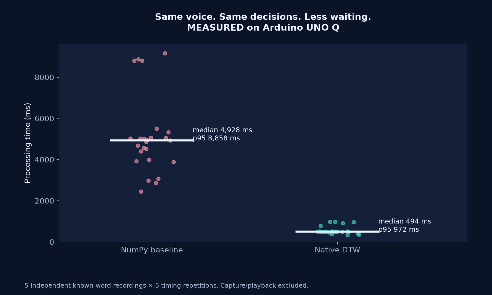
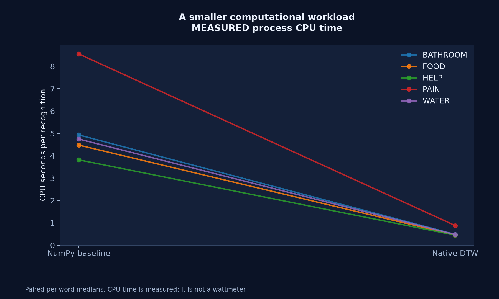
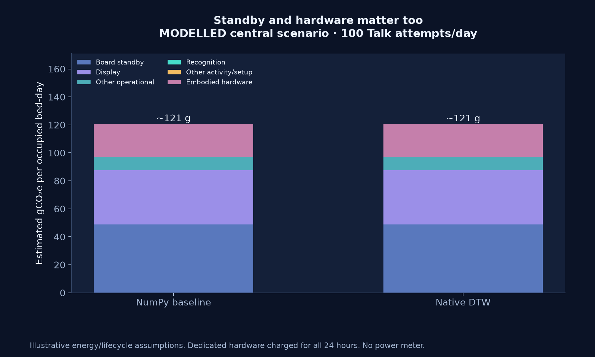
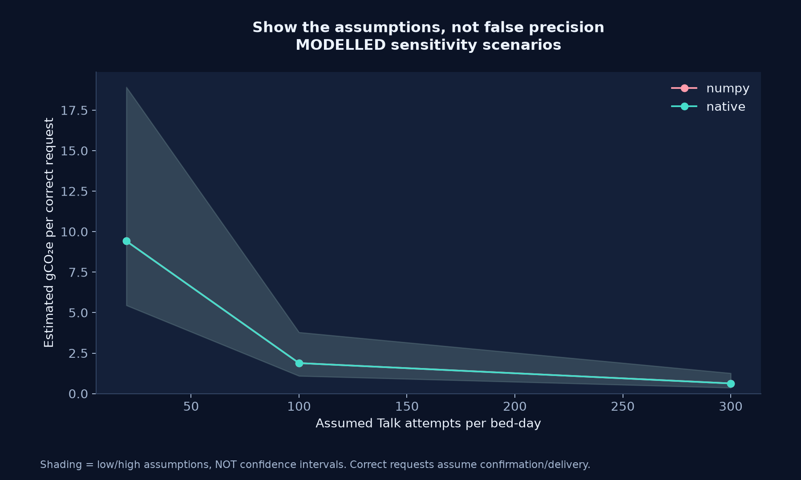
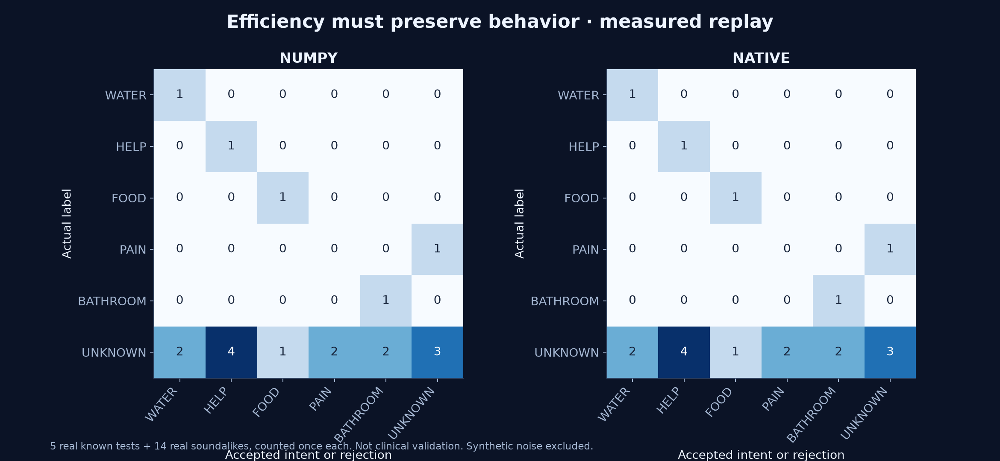

# Sonara: less computation, transparent carbon accounting

**Measured on Arduino UNO Q · Germany · no power meter**

## What changed

Native C DTW performs the same personalized matching as the NumPy baseline. The reference
features, speech/noise checks, distance threshold and intent margins are identical. This study
replays recordings in an isolated process; it does not change the live app, use the microphone,
play audio or create caregiver requests.

## Measured results

| Metric, known-word replay | NumPy | Native |
|---|---:|---:|
| Median processing latency | 4928.1 ms | 494.2 ms |
| 95th-percentile latency | 8857.6 ms | 971.7 ms |
| Median process CPU time | 4.745 s | 0.474 s |

**9.97× median speedup; 90.0% less median CPU time.**
5 repetitions alternate engine order. The corpus contains 5 real known-word tests,
14 real similar-word negatives and 3 explicitly synthetic noise controls. Repetitions
are timing samples, not additional independent speech recordings. All paired decisions and raw
matching scores passed the replay's numerical-equivalence check (tolerance 1e-9).

The sensor-heavy diagnostic collected 300 samples over 1838.0 s. It overran and was not accepted as a clean idle baseline. The short CPU-only follow-up did not yield a retrievable result; no clean idle CPU baseline is claimed.
The initial sensor trace is retained as `idle_sensor_probe_rejected.json` for audit. It is not
used to calibrate power. The supplied collector now has an elapsed-time deadline and optional
thermals. Only temperature sensors were found in the checked standard interfaces; no exposed
board power/energy telemetry was used.
CPU activity is not electricity consumption.

## Modelled SCI results

Functional unit: **one occupied bed-day**, including 24-hour hardware reservation and standby.
SCI = (energy × grid intensity + allocated embodied emissions) / functional unit.

At an **assumed 100 Talk attempts/day**, the central scenario estimates:

| Scenario calculation | NumPy | Native |
|---|---:|---:|
| SCI, gCO₂e per occupied bed-day | 120.641 | 120.560 |
| Modelled energy, kWh per bed-day | 0.238832 | 0.238632 |
| Recognition-increment emissions per attempt | 0.000908 g | 0.000097 g |

The whole-day difference is **0.0811 gCO₂e/day (0.067%)**
under the central assumptions. The native low/high scenario range is **69.8–242.3 gCO₂e/day**.
These are sensitivity scenarios, **not measured emissions or confidence intervals**.

The important result: reducing recognition CPU work does not remove the display, standby power
or manufacturing footprint. A large inference speedup can produce a much smaller estimated
whole-system carbon reduction. Do not present the speedup as an equal reduction in total carbon.

## Quality and limits

On unique real known-word tests: **4/5 correct accepted**,
0 wrong accepted and 1 rejected. Real soundalike false
accepts: **11/14**. Synthetic noise rejected:
3/3. Native and NumPy behavior match.
This small personal development set is not clinical validation or general recognition accuracy.
Physical confirmation remains necessary.

Electricity is estimated from a linear CPU-work power model, not measured. Capture, playback,
confirmation and delivery are simulated. Prompt durations use existing WAV metadata; their CPU
costs, daily workload, device lifespan, resource shares and embodied footprints are assumptions.
The secondary per-correct-request score assumes successful confirmation and delivery; wrong
accepted predictions do not count as productive requests, but their energy remains included.

Boundary: board, 7-inch MPI7010 display, mic/speaker/hub/buttons, allocated router and caregiver
phone, plus amortized local setup. Dedicated devices get full daily allocation; router share is
1/20, phone reservation 30 minutes/day. Research/development runs and remote initial-download
infrastructure are excluded, not claimed zero. Carbon accounting is provisional and model-based.
No offsets or avoided nurse journeys are credited.

## Plots

SVG versions are supplied alongside PNGs for slides and editing.

## Sources and reproducibility

- [SCI specification](https://sci.greensoftware.foundation/): boundary, functional unit and embodied allocation.
- [UBA 2026 report](https://www.umweltbundesamt.de/system/files/medien/11850/publikationen/2026-03/16_2026_CC.pdf): 406 gCO₂e/kWh, estimated German 2025 mix including upstream emissions.
- [Arduino published range](https://store.arduino.cc/collections/single-board-computers): power context only; assigning idle/full endpoints is an assumption.
- [MPI7010 manufacturer information](https://www.lcdwiki.com/7inch_HDMI_Display-D): display identity, not an LCA.
- [Raspberry Pi reports](https://investors.raspberrypi.com/reports) and [Apple product report](https://www.apple.com/environment/pdf/products/iphone/iPhone_15_and_iPhone_15_Plus_PER_Sept2023.pdf): explicitly labelled proxy context, not identification or footprints of Sonara's actual hardware.

See [assumptions](../assumptions.json), [study commands](../README.md), raw replay/idle JSON and
calculated scenario JSON in this directory. Private WAVs and voice templates are excluded from Git.
